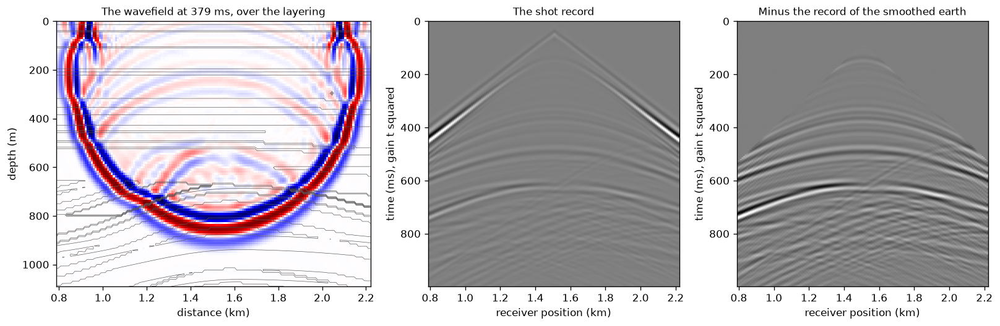

# OgbonLab Notebooks

Runnable seismic modelling notebooks from the [Synthetic Seismic Modeling course](https://ogbonlab.com/textbooks/synthetic-seismic-modeling) at [ogbonlab.com](https://ogbonlab.com).

  
   
  What <a href="notebooks/ssm_field_realistic_section.ipynb">ssm_field_realistic_section</a> computes: the field earth every notebook shares, and the seismic section it produces. numpy and matplotlib only, unedited output of running the notebook.

Each notebook is self-contained: it generates its own data, needs only numpy and matplotlib, and runs top to bottom in under a minute on the free Colab tier. All eight together compute in about a second and a half on an ordinary laptop CPU (about 11 s with a fresh Jupyter kernel started for each). Edit the parameters cell and run again; every value is yours to change.

## One field earth, in every notebook

Every notebook builds on one seeded **field earth**, defined once and carried whole by each: thin sand and shale beds over a regional dip, folded into an asymmetric anticline; normal faults, the largest a listric growth fault whose throw grows with depth and whose hanging wall rolls over into it; uplift and an angular unconformity that cuts the crest; a reservoir sand that subcrops beneath the unconformity, wedges out against it, shales out to the left and is sealed by a shale cap and holds gas over a flat contact; and a draped overburden with a channel. Each rock's velocity follows the compaction trend at its deepest burial, so the uplifted rocks under the unconformity are faster than their depth alone would make them, and sands are soft when shallow and hard when deep; density is Gardner's, and the reservoir and its seal are the course's standard rocks. The sections are imaged with a Ricker whose peak falls with time as a constant Q says, plus noise in the band of the data.

Each notebook first prints the numbers the course's Ask Ogbon advisor computes for the same answers (as `name = value`), then puts the same physics to work in the field earth and prints what it measures there (as `[field] name = value`).

## The notebooks

| Notebook | What it does | Run it |
|---|---|---|
| [ssm_field_realistic_section](notebooks/ssm_field_realistic_section.ipynb) | The flagship: build the field earth in the open, stage by stage, then image it |  |
| [ssm_convolutional_synthetic](notebooks/ssm_convolutional_synthetic.ipynb) | A well drilled into the gas: its logs, its synthetic, and the tie that finds a datum shift |  |
| [ssm_wedge_tuning](notebooks/ssm_wedge_tuning.ipynb) | Tuning along the reservoir's real pinch-out against the unconformity, against the wedge's curve |  |
| [ssm_fault_ml_dataset](notebooks/ssm_fault_ml_dataset.ipynb) | Sections from the field earth's family with pixel-exact fault, horizon or facies labels, saved as .npz |  |
| [ssm_avo_gassmann_dhi](notebooks/ssm_avo_gassmann_dhi.ipynb) | Gassmann puts gas in the trap: near and far stacks with the bright spot and flat spot, and the AVO curves |  |
| [ssm_timelapse_4d_co2](notebooks/ssm_timelapse_4d_co2.ipynb) | A CO2 plume fills the trap: baseline, monitor and difference, the NRMS and the time shifts beneath |  |
| [ssm_acoustic_fd_lab](notebooks/ssm_acoustic_fd_lab.ipynb) | A finite-difference shot through a window of the field earth, and what its structure adds to the record |  |
| [ssm_fracture_avaz_hti](notebooks/ssm_fracture_avaz_hti.ipynb) | Cracks that strike with the faults: the AVAz swing along the reservoir, and the strike recovered |  |

## What they produce

Every figure below is the unedited output of running its notebook top to bottom (`tools/render_assets.py` executes the notebooks and saves what they draw; `tools/render_fd_gif.py` animates the finite-difference notebook's own arrays).

  
   
  What <a href="notebooks/ssm_acoustic_fd_lab.ipynb">ssm_acoustic_fd_lab</a> computes, animated: the notebook's own model, stencil, sponge and source, its wavefield captured as its time loop runs.

  
   
  <a href="notebooks/ssm_acoustic_fd_lab.ipynb">ssm_acoustic_fd_lab</a> · the shot, the record, and what the structure adds to it

  
   
  <a href="notebooks/ssm_convolutional_synthetic.ipynb">ssm_convolutional_synthetic</a> · the well tie in its section, the datum shift found by correlation

  
   
  <a href="notebooks/ssm_wedge_tuning.ipynb">ssm_wedge_tuning</a> · tuning along a real pinch-out

  
   
  <a href="notebooks/ssm_fault_ml_dataset.ipynb">ssm_fault_ml_dataset</a> · varied, faulted, noisy sections with exact labels, saved for training

  
   
  <a href="notebooks/ssm_avo_gassmann_dhi.ipynb">ssm_avo_gassmann_dhi</a> · a bright spot, a flat spot, and AVO at the crest and downdip

  
   
  <a href="notebooks/ssm_timelapse_4d_co2.ipynb">ssm_timelapse_4d_co2</a> · the plume fills the trap; the difference shows it, and the time shifts beneath it

  
   
  <a href="notebooks/ssm_fracture_avaz_hti.ipynb">ssm_fracture_avaz_hti</a> · fractures that strike with the faults, and the strike from azimuthal AVO

  
   
  <a href="notebooks/ssm_field_realistic_section.ipynb">ssm_field_realistic_section</a> · the field earth, built in geological order, before it is imaged

## Three ways to run

1. **One click**: press an Open in Colab badge above. Colab loads the notebook straight from this repository.
2. **Your own copy**: the [Ask Ogbon advisor](https://ogbonlab.com/textbooks/synthetic-seismic-modeling/part-12-the-modeling-lab/whats-next) on ogbonlab.com generates a personalized notebook from your answers. Download it, then upload at [colab.research.google.com/upload](https://colab.research.google.com/upload).
3. **Locally**: `pip install numpy matplotlib jupyter`, then open any notebook.

## Where these come from

The [Synthetic Seismic Modeling course](https://ogbonlab.com/textbooks/synthetic-seismic-modeling) teaches the forward problem in 13 parts: wavelets, reflectivity, the convolutional model, finite differences, elastic AVO, anisotropy, fracture physics, earth models, and a Modeling Lab. The course's closing advisor generates these starter programs; the notebooks here are the curated set with course defaults, plus the flagship field-realistic section built for this repository.

Note: most sections here are the processed, migrated-image idealization, 1D convolution trace by trace in time, with noise in the band of the data; they have no diffractions. The finite-difference lab is the exception: it propagates the full acoustic wavefield, diffractions and all. Each notebook says which it is.

The through-line of the course, and of every notebook here: use the cheapest engine that carries the physics your question depends on.

## License

MIT. Use them in courses, workshops, or your own research.
