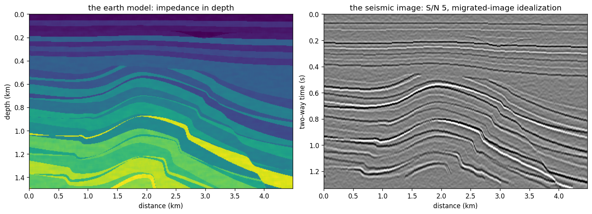
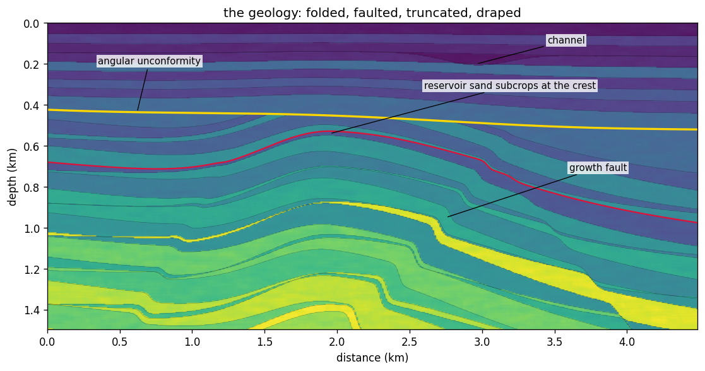

# OgbonLab Notebooks

Runnable seismic modelling notebooks from the [Synthetic Seismic Modeling course](https://ogbonlab.com/textbooks/synthetic-seismic-modeling) at [ogbonlab.com](https://ogbonlab.com).

  
   
  What <a href="notebooks/ssm_field_realistic_section.ipynb">ssm_field_realistic_section</a> computes: a geologically built earth, folded, faulted, truncated, and draped, and the seismic image it produces. numpy and matplotlib only, unedited output of running the notebook.

Each notebook is self-contained: it generates its own data, needs only numpy and matplotlib, and runs top to bottom in under a minute on the free Colab tier (all eight together take under ten seconds on an ordinary laptop CPU). Edit the parameters cell and run again; every value is yours to change.

Four of the notebooks share one **field-realistic earth model**: a deep package of thin beds carrying regional dip and an asymmetric anticline, cut by three normal faults, truncated by an angular unconformity with a reservoir sand subcropping at the crest, then draped by a post-unconformity package with a channel. The well tie sits in it, the wavefield propagates through it, the CO2 plume fills its trap, and the flagship builds it in the open.

## The notebooks

| Notebook | What it does | Run it |
|---|---|---|
| [ssm_field_realistic_section](notebooks/ssm_field_realistic_section.ipynb) | The flagship: build the field-realistic earth, then image it |  |
| [ssm_convolutional_synthetic](notebooks/ssm_convolutional_synthetic.ipynb) | Logs to reflectivity to trace: the well tie, shown in its section |  |
| [ssm_wedge_tuning](notebooks/ssm_wedge_tuning.ipynb) | The wedge model: tuning thickness and vertical resolution |  |
| [ssm_fault_ml_dataset](notebooks/ssm_fault_ml_dataset.ipynb) | Folded, faulted sections with pixel-exact masks: ML training data |  |
| [ssm_avo_gassmann_dhi](notebooks/ssm_avo_gassmann_dhi.ipynb) | Gassmann fluid substitution and AVO: is the bright spot real? |  |
| [ssm_timelapse_4d_co2](notebooks/ssm_timelapse_4d_co2.ipynb) | Baseline vs monitor for a CO2 plume filling the field model's trap |  |
| [ssm_acoustic_fd_lab](notebooks/ssm_acoustic_fd_lab.ipynb) | A finite-difference wavefield propagating through the field model |  |
| [ssm_fracture_avaz_hti](notebooks/ssm_fracture_avaz_hti.ipynb) | HTI rock physics and azimuthal AVO: recover fracture strike |  |

## What they produce

Every figure below is the unedited output of running its notebook top to bottom (`tools/render_assets.py` executes the notebooks and saves what they draw).

  
   
  What <a href="notebooks/ssm_acoustic_fd_lab.ipynb">ssm_acoustic_fd_lab</a> computes, animated: the same arrays the notebook plots, rendered as its time loop runs, through the field model's fold, faults, and unconformity.

| | |
|:---:|:---:|
|  |  |
| [ssm_convolutional_synthetic](notebooks/ssm_convolutional_synthetic.ipynb) · the well tie, in its section | [ssm_fracture_avaz_hti](notebooks/ssm_fracture_avaz_hti.ipynb) · fracture strike from azimuthal AVO |
|  |  |
| [ssm_wedge_tuning](notebooks/ssm_wedge_tuning.ipynb) · where thin beds stop being resolvable | [ssm_avo_gassmann_dhi](notebooks/ssm_avo_gassmann_dhi.ipynb) · is the bright spot fluid or lithology? |

  
   
  <a href="notebooks/ssm_fault_ml_dataset.ipynb">ssm_fault_ml_dataset</a> · folded, faulted, noisy sections with pixel-exact labels, ready for training

  
   
  <a href="notebooks/ssm_timelapse_4d_co2.ipynb">ssm_timelapse_4d_co2</a> · the plume fills the trap; the difference shows it, plus the time shifts every real 4D carries

  
   
  <a href="notebooks/ssm_field_realistic_section.ipynb">ssm_field_realistic_section</a> · the geology, assembled and annotated, before it is imaged

## Three ways to run

1. **One click**: press an Open in Colab badge above. Colab loads the notebook straight from this repository.
2. **Your own copy**: the [Ask Ogbon advisor](https://ogbonlab.com/textbooks/synthetic-seismic-modeling/part-12-the-modeling-lab/whats-next) on ogbonlab.com generates a personalized notebook from your answers. Download it, then upload at [colab.research.google.com/upload](https://colab.research.google.com/upload).
3. **Locally**: `pip install numpy matplotlib jupyter`, then open any notebook.

## Where these come from

The [Synthetic Seismic Modeling course](https://ogbonlab.com/textbooks/synthetic-seismic-modeling) teaches the forward problem in 13 parts: wavelets, reflectivity, the convolutional model, finite differences, elastic AVO, anisotropy, fracture physics, earth models, and a Modeling Lab. The course's closing advisor generates these starter programs; the notebooks here are the curated set with course defaults, plus the flagship field-realistic section built for this repository.

Note: the sections here are the processed, migrated-image idealization (per-trace 1D convolution in time), with band-limited noise at survey-quality S/N. The finite-difference lab is the exception; it propagates the full acoustic wavefield, diffractions and all. Each notebook says which it is.

The through-line of the course, and of every notebook here: use the cheapest engine that carries the physics your question depends on.

## License

MIT. Use them in courses, workshops, or your own research.
